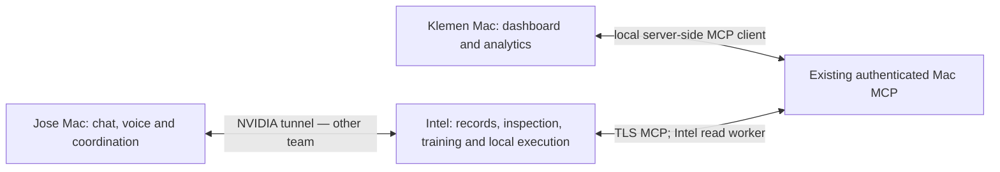

# Final three-host ownership and transport

Owner direction recorded **November 15, 2026**, Europe/Ljubljana (UTC+01:00). The owner's architecture sketch (`IMG_3434.jpg`, retained in the original workspace) and subsequent transport clarification supersede earlier host placement and the mandatory ElevenLabs provider choice. Preserve historical implementation and evidence; this architecture does not establish working physical integration.

## Target ownership

| Host / owner | Code and responsibility | Boundary |
| --- | --- | --- |
| Klemen Mac | Morph dashboard, quality/history, reliability analytics, saved-export audit; approved evidence-analyst work belongs to this view | Reads Intel's authoritative data through the existing Mac MCP. No robot commands on load, refresh, reconnect or replay. |
| Jose Mac | Interaction/chat UI, coordination/control, Nemotron observations, Gemini task/goal selection; voice is expected here | Will send permitted missions through the NVIDIA tunnel supplied by the other team. Intel must implement the locally validated mission dispatcher before this path can control the robot. |
| Intel PC | Physical AI Studio, demonstrations/training, learned policies, cameras, Anomalib/OpenVINO, validated skill execution and authoritative session/cycle/attempt/outcome records | Owns authoritative data for both Macs and must implement the mission/physical execution interface behind the externally owned tunnel. |

The sketch includes OpenClaw, Gemini Argon and Decision 1, VLA/VLM/world-model labels. These describe intended components and ownership. No local OpenClaw/Argon adapter or world-model implementation was found in the reviewed Mac source. Decision 1 remains a fixed-choice API; it must not be treated as a generative planner. Existing Gemma analyst work remains distinct from Gemini orchestration and cannot change records or dispatch motion.

**Voice is expected on Jose's Mac; ElevenLabs is undecided.** Preserve the existing optional Scribe adapter and its dated software/provider evidence. Do not require its credentials to start the UI. No alternative speech provider has been selected or implemented by this split.

## Transport

The MCP connection uses the existing private pairing configuration and CA. No credentials belong in a handoff ZIP, browser bundle or source response. The NVIDIA tunnel is explicitly **outside this repository's implementation scope**; the other team supplies its URL, authentication and reachability. A tunnel alone does not implement the mission API or validate a physical action.

The Station GET relay in the original workspace's separate communication package carries exact allowlisted GET responses from Intel to Klemen, including metadata, saved analyzed images, records, counters and finite event batches. It introduces no second source of reliability records. Requests have unique IDs, expire after 30 seconds, and multipart responses must pass SHA-256 verification. Loss of the Intel worker produces an unavailable response, not cached data labeled live. Continuous video, changes to reference labels/outcomes and robot control are outside this read relay.

## Current source split

This repository contains the **Jose control partition**. It originated in the shared workspace at `handoff/three-host-20261115/jose-control/`. The sibling `klemen-dashboard/` and `intel-runtime/` packages belong to that original workspace and are not directories in this checkout. Copies of common records/models in development packages are explicitly dependencies or simulation fixtures; Intel owns canonical runtime data.

The original shared workspace retains the Mac station source and the sibling `morph-station/` dashboard. This repository also includes the verified **17-file current Intel records API/import closure**, kept separately in `intel-contract/`, with 56 guarded source tests passing. This is a focused current-source delivery, not the entire Intel project. **Do not replace Intel's working tree with the Mac baseline package.** The actual mission/control service and physical adapters remain absent from the received source and current Intel inventory; [Intel delivery status](INTEL_REQUIRED_FOR_JOSE.md) records the exact scope.

Jose can start from the supplied control/voice lab and contracts while the current Intel source is reconciled. The lab is an explicit simulator, not a completed production chatbot or a working robot mission client. Models still select only allowed choices. The future Intel mission service must validate versions, freshness, preconditions, expiry and duplicate execution IDs at the execution boundary; the current records API does not implement that service.

## Remaining integration acceptance

- Reconcile the received current Intel records API/import closure. Obtain actual camera/skill interfaces if implemented separately, or implement the absent mission/physical integration with its owner.
- Use the separate communication package to start its read worker on Intel against the actual records API and existing MCP pairing, then verify dashboard reads from that host.
- The other team establishes the NVIDIA tunnel. Jose implements its application mission client against the actual validated Intel contract.
- Confirm voice deployment/provider choice; implement remaining chat/Argon/OpenClaw components only with demonstrated distinct purpose.
- Preserve M15/M16 accepted scope and complete the still-open live/physical M12–M24 criteria tracked in the original workspace task plan, with appropriate evidence. Packaging, local MCP tests and simulation are separate from physical verification.
