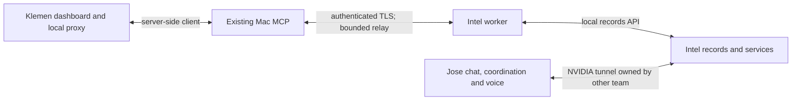

# Three-host ownership and dashboard connection

Owner direction recorded November 15, 2026, Europe/Ljubljana (UTC+01:00). The supplied architecture assigns the dashboard and analytics to Klemen, chat/coordination and probably voice to Jose, and authoritative records, training and physical execution to Intel. ElevenLabs is now undecided; preserve earlier adapters and dated evidence without making the provider a startup requirement.

| Host | Responsibility | Connection and authority |
| --- | --- | --- |
| Klemen Mac | Live/system/history views, audited reviews, saved-evidence Gemma UI and offline export analysis | Uses the existing authenticated Mac MCP; does not dispatch robot motion. |
| Jose Mac | Operator interaction, chat, Nemotron observations and Gemini fixed-choice coordination; expected voice host | Connects to Intel through the NVIDIA tunnel supplied by the other team. |
| Intel PC | Authoritative records, review validation, Gemma service, physical training and local execution ownership | Validates application requests and remains the physical execution authority. |

The dashboard's browser receives no pairing token or provider key. Its loopback proxy uses the existing private pairing directory and verifies the MCP TLS certificate. Relay requests expire, responses have bounded pages and an exact SHA-256, and worker loss produces unavailable/stale state. The relay has no second authoritative store.

The dashboard can read existing data and make two explicit record/service requests: `record-review` for a saved cycle review and `evidence-analysis` for a Gemma report. The proxy, relay and worker permit only those exact POST routes, retain body bytes and stable application IDs, and never retry them automatically. The worker requires an explicit write opt-in. Opening the dashboard, refreshing, reconnecting and replay do not initiate either request or a robot movement.

Gemma explains selected saved evidence. Its text cannot relabel, change measured outcomes, select a robot mission or issue motion commands. Operator review is a separate attributed, revision-checked backend transaction. Gemini orchestration remains distinct and uses defined permitted choices; it is not a source of generated joint commands.

This package reconciles the received M16/Gemma frontend/client with the Mac MCP adapter. [README.md](README.md) documents its portable `dashboard/`, `station-client/` and `analytics/` layout; [SOURCE_RECONCILIATION.json](SOURCE_RECONCILIATION.json) records exact source provenance. It does not replace Intel's working tree or establish that its runtime is current. The earlier Mac handoff and archive remain separate.

Deployment of the upgraded communication/worker code, current Intel API selection and the real cross-host checks remain integration work. The other team owns the NVIDIA tunnel. Mission/dispatcher/learned-skill source and physical acceptance remain unavailable in the received source; voice provider selection is open. See [SOURCE_GAPS.md](SOURCE_GAPS.md) and [VERIFICATION.md](VERIFICATION.md).
