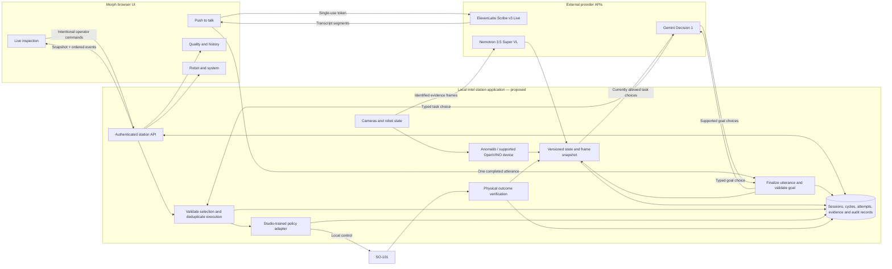

# Morph dashboard — integration contract

**Design handoff, November 14, 2026.** This document defines a proposed application contract for the teammate building Morph in Google AI Studio. It is not an implemented API or a report of a working robot. The owner-selected architecture is recorded in [PHYSICAL_AI_ORCHESTRATION.md](../../PHYSICAL_AI_ORCHESTRATION.md) and [PHYSICAL_AI_WORKFLOW.md](../../PHYSICAL_AI_WORKFLOW.md); shared measurement rules are in [AGENTS.md](../../AGENTS.md).

## 1. What exists and what must be built

At this review the project contains documentation, setup scripts, dependency profiles and synthetic installation checks. No project dashboard, station API, session database or model-to-robot dispatcher was found outside prepared dependencies. The [setup record](../../PHYSICAL_AI_SETUP.md) reports successful synthetic Anomalib fitting and model export on the Mac, but failed Mac OpenVINO execution and no quality/parity result. Intel installation, actual cameras, calibration, trained skills, all three external model accounts and an autonomous physical cycle remain unverified.

Build the UI against an explicit **Simulation** adapter first. The hardware adapter must begin with **Unavailable / Not verified** values. A polished screen, provider documentation, successful build or simulated replay does not change capability status to verified.

| Component | Required contribution | UI evidence | Current project status |
| --- | --- | --- | --- |
| Physical AI Studio + learned VLA/policy | Learn manipulation from our demonstrations and execute supported tasks using observations | Policy/version, selected task, execution lifecycle, physical confirmation | Setup prepared; policy execution unverified |
| Anomalib + supported OpenVINO path | Supply the defect score, map, threshold and classification used in sorting | Exact analyzed frame and measurement; actual model/device/configuration | Synthetic fit/export only; useful detector and target execution unverified |
| NVIDIA Nemotron 3.5 Super VL | Supply visual context at inspection/recovery checkpoints | Frame-linked observations; separately labeled hypotheses/uncertainty | Published model reference verified; account/image request unverified |
| Gemini Decision 1 | Select a supported goal and a permitted next task online | Offered choices, typed answer, selection accepted/rejected and its execution | Published Decisions API verified; account request unverified |
| ElevenLabs Scribe v3 Live | Turn deliberately captured speech into a finalized operator utterance | Original transcript, selected intent and queued/active/rejected state | Published realtime API verified; microphone/account test unverified |
| Local station application | Persist state, validate decisions, dispatch tested tasks, verify outcomes | Accepted commands, status changes, evidence and complete history | Proposed in this handoff |

Do not use the Stitch mockup's `Octo-VLA v2.4`, `DaVinci-9 NPU`, fictional 48 V power bus, pneumatic brake state, 98.4 bpm heartbeat, 4K/60 FPS, calibrated crack widths, force readings or benchmark results as project facts. The brief's physical object is a **Duplo brick**, not the bearing shown in those concepts. Learned policy identity and camera specifications must come from the eventual station configuration.

## 2. Architecture and deployment



**Recommended first implementation:** React + TypeScript frontend; one local station API using the prepared Python/FastAPI environment; SQLite with transactional writes; original images on local disk referenced by immutable evidence IDs. This is an implementation proposal, not an added sponsor dependency. Keep Studio and Anomalib in their separate prepared environments and expose narrow adapters. Do not install their conflicting dependencies into the dashboard environment.

Google AI Studio currently documents a React frontend by default, a Node.js server runtime, server-side secrets, GitHub synchronization and ZIP export. Use it to build and review the frontend and its simulated API adapter. Export the project so the real frontend can be served beside the Intel station API, or deliberately implement and test a secured bridge. An AI Studio/Cloud Run deployment does not automatically gain access to the robot, USB cameras or `localhost` on the Intel machine. Avoid two competing sources of state in a cloud Node server and a local Python server. [V1]

The actual Studio conditioning/task-switching interface is an integration discovery item. `pick` and the other task IDs below are **Morph application names**, not claimed Studio SDK methods. Do not invent SDK calls. Resolve each through a tested adapter and the actual installed Studio version. Preserve the learned, perception-dependent local policy contribution. [P1] [V6]

## 3. What every screen reads

All three views must use the same station records. Navigation never recomputes truth from DOM state or increments counters. Keep the transport mode separate from the source of a session: replay reads an existing live or simulated session; it creates no new records.

The following TypeScript is a proposed domain model, not a vendor payload:

```ts
type ID = string;
type ISOTime = string; // ISO 8601 UTC, e.g. 2026-11-14T13:30:00.000Z
type SourceMode = "live" | "simulation";
type ViewMode = "live" | "simulation" | "replay";
type Outcome = "in_progress" | "correct" | "failed" | "aborted" | "unverified";
type AttemptOutcome = "in_progress" | "successful" | "failed" | "aborted" | "unverified";
type Quality = "good" | "defective";
type Destination = "good_bin" | "defective_bin";
type CapabilityStatus = "proposed" | "implemented" | "verified";

interface Session {
  id: ID; name: string; sourceMode: SourceMode;
  startedAt: ISOTime; endedAt: ISOTime | null;
  configId: ID; robotId: ID | null;
  modelRuns: { provider: string; modelId: string; version: string | null;
    device: string | null; precision: string | null }[];
}
interface Frame {
  id: ID; sessionId: ID; cycleId: ID; objectId: ID; cameraId: ID;
  capturedAt: ISOTime; receivedAt: ISOTime;
  width: number; height: number; imageUrl: string; sha256: string;
}
interface Confirmation {
  id: ID; source: "camera" | "sensor" | "operator";
  evidenceIds: ID[]; authorId: ID | null; confirmedAt: ISOTime;
}
interface Cycle {
  id: ID; sessionId: ID; objectId: ID; revision: number;
  startedAt: ISOTime; endedAt: ISOTime | null; outcome: Outcome;
  attemptIds: ID[]; inspectionIds: ID[]; decisionIds: ID[];
  commandedDestination: Destination | null;
  observedDestination: Destination | "other" | null;
  referenceLabelId: ID | null; confirmationId: ID | null;
}
interface Attempt {
  id: ID; cycleId: ID; ordinal: number; executionIds: ID[];
  startedAt: ISOTime; endedAt: ISOTime | null; outcome: AttemptOutcome;
  retryOfAttemptId: ID | null; retryReason: string | null;
  errorCode: string | null; confirmationId: ID | null;
}
interface Inspection {
  id: ID; cycleId: ID; objectId: ID; frameIds: ID[];
  modelRunId: ID; score: number; threshold: number;
  classification: Quality | "review_required";
  mapEvidenceId: ID | null; additionalInspectionOfId: ID | null;
  requestedAt: ISOTime; completedAt: ISOTime;
}
interface ReferenceLabel {
  id: ID; objectId: ID; cycleId: ID; quality: Quality;
  authorId: ID; method: string; evidenceIds: ID[]; createdAt: ISOTime;
}
interface Correction {
  id: ID; entityType: string; entityId: ID; field: string;
  previousValue: unknown; newValue: unknown;
  authorId: ID; reason: string; createdAt: ISOTime;
}
interface TelemetryValue {
  value: number | null; unit: string; measuredAt: ISOTime | null;
  state: "available" | "stale" | "unavailable" | "error";
}
```

Use `null` for absent measurements. Render **Unavailable**, not `0`, `0%`, a guessed force or a guessed device utilization. A reference label is independent of the model prediction; a manual label does not silently overwrite an Anomalib result. Define whether the reference remains valid when an object is physically changed between tests.

Each physical attempt covers one attempted physical task execution for the object and may contain several learned skill executions (pick, present and place). A skill invocation is not automatically a new attempt. A failed grasp followed by a retry is one cycle and two attempts. An additional inspection is counted separately; executing a supported additional view does not by itself create a new attempt. A new independent test using the same object creates a new cycle. [P2]

## 4. Proposed station API

The paths in this section are **new Morph endpoints to implement**. They are not existing local endpoints and are not vendor APIs. The UI should depend on one `StationClient` interface so the simulation adapter can later be replaced without changing components.

| Method and path | Purpose and response |
| --- | --- |
| `GET /api/v1/station/snapshot` | Authoritative station/session/cycle state, current goal, component status, available actions and latest event sequence |
| `GET /api/v1/events?after=<sequence>` | Ordered Server-Sent Events; reconnect from the last applied sequence |
| `GET /api/v1/sessions` | Saved session metadata with live/simulated source |
| `POST /api/v1/sessions` | Create a named session; no implicit movement |
| `POST /api/v1/sessions/:id/end` | End session bookkeeping according to policy; retain open cycle status; reject or show an explicit unresolved-cycle condition |
| `GET /api/v1/sessions/:id/metrics` | Metrics derived from persisted records, with all numerators/denominators and filters |
| `GET /api/v1/cycles?...` | Filter by session, object, outcome, retry, failure code, model, time and reference status |
| `GET /api/v1/cycles/:id` | Full trace: images, inspection revisions, decisions, attempts, outcomes and audit history |
| `GET /api/v1/evidence/:id` | Immutable analyzed/original/verification evidence; authorize access |
| `GET /api/v1/cameras` | Available camera descriptors, timestamps and negotiated stream metadata |
| `GET /api/v1/cameras/:id/stream` | Actual supported stream transport; choose MJPEG/WebRTC during hardware integration |
| `POST /api/v1/commands` | Intentional start-cycle, pause-after-cycle, resume or supported software-stop command; return a command record |
| `POST /api/v1/voice/token` | Authenticated single-use ElevenLabs realtime token; long-lived key stays on server |
| `POST /api/v1/voice/utterances` | Finalize exactly one utterance; same utterance ID returns the existing command |
| `POST /api/v1/cycles/:id/reference-labels` | Independent operator label with author, method/evidence and audit record |
| `POST /api/v1/corrections` | Version-checked correction with previous/new value, author, reason and time |
| `GET /api/v1/sessions/:id/export?format=csv` | Explicit flat export including outcome/source categories and IDs |
| `GET /api/v1/sessions/:id/export?format=json` | Full nested trace, model metadata, schema version and corrections |

Persist state, record revisions and emitted events in one transaction. Use unique entity IDs and execution IDs, with an outbox or equivalent durable dispatch journal. The robot adapter must recognize the same execution ID after a process restart. If delivery is uncertain, reconcile the execution status before retrying; do not issue a second movement under a new ID just because a request timed out.

Example command body (proposed):

```json
{
  "id": "cmd-example-01",
  "sessionId": "session-example",
  "cycleId": "cycle-example",
  "type": "pause_after_cycle",
  "expectedStateVersion": 24,
  "expectedGoalVersion": 3,
  "requestedBy": "operator-example",
  "source": "dashboard"
}
```

Normal commands use optimistic version checks and return a recorded rejection on stale state. A supported urgent software-stop request needs its own controller-defined idempotent path: never make a necessary stop depend on a stale UI version becoming current. This still does not turn a network request into a hardware emergency stop.

Example ordered event envelope (values are illustrative):

```json
{
  "schemaVersion": 1,
  "eventId": "evt-example-29",
  "sequence": 29,
  "type": "execution.finished",
  "occurredAt": "2026-11-14T13:30:02.800Z",
  "receivedAt": "2026-11-14T13:30:02.814Z",
  "sourceMode": "simulation",
  "sessionId": "session-example",
  "cycleId": "cycle-example",
  "attemptId": "attempt-example-1",
  "entityId": "execution-example",
  "entityRevision": 4,
  "payload": {
    "controllerStatus": "finished",
    "physicalOutcome": "unverified"
  }
}
```

Apply events once by `eventId`, respect `entityRevision`, and detect gaps in `sequence`. On a gap, request the missing events or refresh the authoritative snapshot. Repeated completion messages, reconnects and browser refreshes must not add cycles or attempts. A later `outcome.confirmed` updates the original entity, recomputes affected metrics and retains the previous result in its revision/audit history.

## 5. Frames, perception and current-object layout

The camera viewport may show the most recent stream. The analyzed snapshot beside it must remain fixed to its `frameId`, capture time and object/cycle. An anomaly overlay is valid only over the frame or registered geometry it was computed from; do not paint a historical map onto a moving live stream without registration. Camera switching does not relabel an analysis as though it used the newly selected camera.

Show `Captured`, `Frame age`, actual FPS and connection state. A frozen image remains visible with **Stale — last received …**. Configure freshness thresholds from the measured station behavior; do not hard-code an unsupported camera SLA. Use receipt time for transport health and capture time for evidence age, allowing for recorded clock synchronization uncertainty.

Nemotron records should contain the actual model ID, input frame IDs, request/response timestamps, raw response artifact, parsed visual observations, separately identified hypotheses and parse errors. Use schema validation where the provider supports it; unsupported or malformed results stay visible as rejected evidence. Do not invent a model rationale or convert its description into a ground-truth label. [P1]

The verified NVIDIA reference is `nvidia/nemotron-3.5-super-vl-120b-a12b`. Confirm the provider's actual available endpoint and returned model with a minimal image request before claiming integration. NVIDIA GPU hosting alone does not satisfy this model requirement. [V3]

## 6. Decision 1: two dependent decisions composed locally

The current Google Decisions API evaluates fixed choice/yes-no/rubric questions and returns typed probabilities with zero generated text tokens. It does not produce a plan, function-call arguments or explanatory prose. A choice question distributes probability over the offered choices even when none is suitable. Include a `hold` or `unsupported_request` option. Set acceptance thresholds through application evaluation, not a decorative percentage in the UI. Independent questions in one API call are not a sequential workflow. [V2]

**Goal selection:** send one finalized utterance plus the existing goal, current phase and supported goal descriptions. The proposed menu is `standard_sorting`, `extra_view_next_reject`, `pause_after_cycle`, `resume`, `unsupported_request`. Store the original language and text. A selected goal is then validated, queued if necessary and committed locally with a new `goalVersion` at the defined boundary.

**Task selection:** after the goal commit, build a fresh snapshot including `sessionId`, `cycleId`, `attemptId`, `stateVersion`, `goalVersion`, `frameIds`, capture times, phase, Anomalib result, Nemotron observations, permitted task IDs, request time and deadline. Ask Decision 1 to select from only these currently allowed tasks plus `hold`. Proposed task names are `pick`, `present_for_inspection`, `reinspect_other_view`, `place_good`, `place_defective`, `hold`; actual availability depends on demonstrated skills.

A minimal server-side request shape based on the verified vendor documentation is:

```ts
// Proposed Morph adapter sketch; not tested against a project account.
// Pin and verify the actual SDK version before implementation.
const result = await ai.decisions.create({
  model: "gemini-decision-1",
  input: JSON.stringify(snapshot),
  questions: {
    next_task: {
      type: "choice",
      instructions: "Choose one currently permitted task for this snapshot.",
      criteria: allowedTaskDescriptionsIncludingHold
    }
  }
});
const answer = result.answers?.next_task;
// Validate the response and current station state before any dispatch.
```

Google currently documents `POST https://generativelanguage.googleapis.com/v1beta/decisions` and SDK `decisions.create`. Store the returned answer exactly, including available probabilities/confidence, separately from local acceptance. Do not add a `reasoning` field that the API never returned. A UI explanation such as **Held: evidence stale** is a labeled local validation result. [V2]

Immediately before dispatch recheck state/goal versions, object/frame associations, freshness, deadline, allowed task, preconditions, retry budget and execution ID. Resolve task parameters from validated local configuration. A cloud result never becomes raw joint commands. Late, unavailable, malformed or out-of-state answers are recorded and follow the phase's specified hold/recovery behavior; uncertainty must not silently route to the good bin.

## 7. Voice finalization and UI states

Use push-to-talk. The backend creates a single-use realtime Scribe token; the browser may stream microphone audio directly using that token. Keep all long-lived provider keys on the server. The current ElevenLabs client guide documents `scribe_v3_live`; its events distinguish provisional text from stable committed segments and later enrichment. [V4] [V5]

Display states: **Ready → Listening → Finalizing → Selecting goal → Queued → Active**, with **Rejected / Unavailable** branches. A transcript bubble contains the operator's original words; a separate line contains the accepted goal and effective boundary.

Create `utteranceId` at intentional capture start. Retain committed segments in order and finalize the complete utterance only when the capture ends and all expected final segments are resolved. If finalization times out or is ambiguous, show the retained transcript for explicit retry/review and issue no command. Do not create one goal per segment. `partial_transcript` is display-only; `committed_transcript_with_timestamps` and other enrichment update the matching transcript record and never create another goal. Deduplicate finalization by utterance ID at the backend. [V5]

A typed fallback may use the same goal validator, with `source: "typed"` visibly recorded. It does not count as evidence that ElevenLabs was used. Optional spoken acknowledgments must follow real queued/active/completed events and avoid being recaptured as operator speech.

## 8. Robot controls and failure states

Keep the prominent red action labeled **STOP** with **Software stop** nearby unless actual hardware emergency-stop integration is separately verified. Clicking it sends the supported stop request immediately, then opens a status dialog showing **Requested**, **Acknowledged**, controller status and **Physical stop verified / Unverified** from available evidence. Do not delay a supported stop request behind a confirmation modal. If the robot interface has no supported stop operation, disable the control and show that limitation; do not claim a command was sent.

The dialog must not claim power disconnection, brake engagement, compliance certification or a safe robot merely because a UI flag changed. Closing the dialog or acknowledging the incident does not resume movement. Resume is a separate intentional action and remains disabled until the actual restart conditions hold. A lost connection is an unknown physical outcome, not proof that the arm stopped.

**Pause after cycle** stops admission of new cycles once the active cycle reaches its defined end. Show requested and acknowledged states separately. **Start session** only creates bookkeeping. **Start cycle** requires an intentional command and current prerequisites. Opening a page, camera, replay or history never moves the robot. End-session behavior preserves any unresolved cycle; no automatic success or undocumented abort is allowed. [P2]

The controller's real stop, interruption and restart semantics must be verified with the station instructions before connecting these actions. A voice command follows this same software control path and never substitutes for the physical emergency stop.

## 9. Metrics and timing contract

Return every percentage as `{ numerator, denominator, value: number | null, definition, filters }`. A zero eligible denominator renders **No data yet**. Metrics must be query results over unique persisted records. Include the source mode, selected session/time window and excluded in-progress count.

| Metric | Definition |
| --- | --- |
| Confirmed correct cycles | Correct / all finished cycles. Finished includes correct, failed, aborted and unverified; excludes in progress. Show each category. |
| Physical execution | Successful / all finished attempts, with failed, aborted and unverified categories visible. |
| First-attempt success | Correct cycle completed on its first physical attempt with required confirmation; additional inspections are reported separately. |
| Recovered success | Correct cycle with at least one earlier failed physical attempt. Preserve those failures. |
| Retries | Physical attempts after the first attempt in each cycle; count from attempt records. |
| Additional inspections | Inspections explicitly linked to an earlier inspection, independently of physical retry counts. |
| Detection correctness | Correct classifications among independently reference-labeled eligible examples; show checked examples and total population. |
| Defect escape | Defective reference, predicted good. Show the count and denominator when expressing a rate. |
| Streak | Consecutive confirmed correct cycles in the chosen ordering; failed, aborted and unverified results break it. Late corrections recalculate history. |

For the confusion matrix, define **positive = defective**. TP = defective/rejected; TN = good/accepted; FN = defective/accepted; FP = good/rejected. Reference-labeled `review_required` examples need a separate unresolved-classification count; do not force them into the 2×2 cells or hide them from coverage. Choose one documented decision inspection per cycle for cycle-level detection metrics; extra frames must not inflate the object population. Preserve all inspections for detailed review.

Separate these timing boundaries:

- **Anomalib latency:** input submitted to usable inspection result; separately retain inference-only measurement when instrumented.
- **Nemotron and Gemini latency:** request start to complete usable response, including transport; retain timeout/error samples.
- **Goal response:** end of spoken capture to accepted/queued goal; separately record transcription and decision time.
- **Motion:** actual controller motion start to motion end, when those signals exist; acknowledgment-to-finished is not silently called motion time.
- **Verification:** verification start to confirmed result or declared unverified end.
- **Full cycle:** cycle start to recorded finish, including cloud waiting, extra inspections, retry, motion and verification. Durations from parallel operations are not summed as though serial.

Use monotonic clocks for durations within a process and UTC timestamps for persisted events. Label display timezones explicitly, for example **Europe/Helsinki (UTC+02:00)** during Junction on November 14–15, 2026; the user's Mac is **Europe/Ljubljana (UTC+01:00)** on these dates. Never substitute receipt time for capture time. Use p50/p95 only with visible sample count and timing method.

OpenVINO comparisons require actual model/configuration, device, precision, input set, threshold, warm-up and measurement method, sample count and quality results. Report model speedup separately from full-cycle improvement. Until real comparable measurements exist, the panel reads **Benchmark not recorded**. The Stitch numbers are not baseline data. Compare fixed-sequence and adaptive runs on comparable cases, retaining failed and uncertain outcomes. [P1] [P2]

## 10. Implementation order and acceptance

1. Implement typed records, persistence, correction audit and metrics. Prepare labeled simulation fixtures for success, failed grasp + retry, extra inspection, wrong-bin outcome, unverified connection loss and empty history.
2. Build the three views and per-cycle detail against the same `StationClient`. Add replay as a read-only transport over saved records, plus CSV/JSON exports.
3. Verify target equipment and Studio interfaces. Connect real camera metadata/frames and truthful component/telemetry states.
4. Implement and physically verify one baseline local cycle: observe → pick → verify grasp → present → inspect → choose response → place → verify outcome. Persist evidence from the first test.
5. Connect actual Anomalib and policy outputs, supported OpenVINO execution and outcome confirmation. Mark only completed checks verified.
6. Validate Nemotron with real identified frames, then Decision 1 with permitted tasks, state/goal checks and one bounded supported recovery.
7. Integrate ElevenLabs, complete utterance finalization, supported goal selection and the queued-to-active boundary. Demonstrate an actual spoken goal change.
8. Record comparable physical baseline/adaptive results and measured optimization evidence. Export one complete reproducible session for review.

Acceptance must cover duplicate events and execution IDs, two failed grasps before recovery, extra inspection without a new attempt, stale decisions after a goal change, partial/enriched transcript deduplication, provider timeout, reconnect/refresh, out-of-order events, late confirmation, audited manual correction, new session totals, session end with an open cycle, empty metrics and replay without new live records. Verify that no mount, route change or reconnect dispatches motion. A UI simulation pass is recorded separately from a physical hardware pass.

## 11. Sources and verification boundary

The technical vendor pages below were fetched and read on **November 14, 2026**. This verified published API descriptions only. No credentials were inspected, provider accounts activated, real inference requests sent or robot controls exercised for this handoff. Exact installed SDK compatibility, access/quota and hardware behavior still require testing.

- **P1:** [Project architecture](../../PHYSICAL_AI_ORCHESTRATION.md) and [primary workflow](../../PHYSICAL_AI_WORKFLOW.md), selected November 14, 2026.
- **P2:** [Workspace definitions](../../AGENTS.md) and [actual setup/verification record](../../PHYSICAL_AI_SETUP.md).
- **V1:** [Google AI Studio Build mode](https://ai.google.dev/gemini-api/docs/aistudio-build-mode): frontend/server environment, secrets, export and deployment behavior.
- **V2:** [Google Decisions API](https://ai.google.dev/gemini-api/docs/decisions-api) and [Gemini Decision 1 model](https://ai.google.dev/gemini-api/docs/models/gemini-decision-1): typed choice contract and model boundary. The Decisions page was directly reviewed; model identity is additionally recorded in the existing architecture review.
- **V3:** [NVIDIA Nemotron 3.5 Super VL reference](https://docs.api.nvidia.com/nim/reference/nvidia-nemotron-3_5-super-vl-120b-a12b): exact published model identifier.
- **V4:** [ElevenLabs client-side realtime transcription](https://elevenlabs.io/docs/eleven-api/guides/how-to/speech-to-text/realtime/client-side-streaming): single-use token and `scribe_v3_live`.
- **V5:** [ElevenLabs realtime event reference](https://elevenlabs.io/docs/eleven-api/guides/how-to/speech-to-text/realtime/event-reference): partial, committed and enrichment events.
- **V6:** [Physical AI Studio library documentation](https://github.com/open-edge-platform/physical-ai-studio/blob/main/library/docs/index.md), referenced by the existing architecture review. Installed version/interface facts must follow the pinned setup profile and the actual station; this handoff does not establish a new latest-version claim.

All endpoint names under `/api/v1`, TypeScript types, persistence choices, UI states and implementation stages in this file are **Morph design proposals** derived from the project's agreed requirements. They must be implemented and tested before being presented as capabilities.
