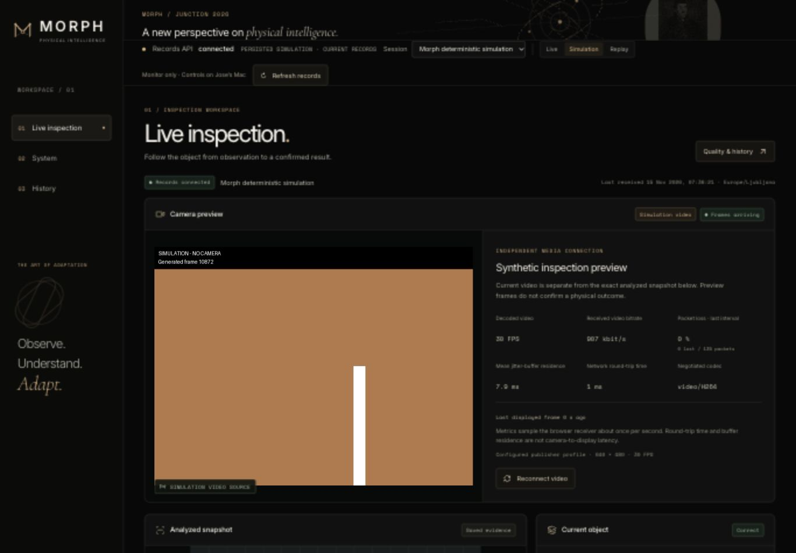

# Live video software verification — November 15, 2026

The implemented Mac dashboard/Intel-source adapter is verified with **synthetic input on the Mac**. Actual Intel deployment, Studio capture ownership, hardware encoding, model-workload performance and camera-to-display latency remain unverified. The source handoff does not trigger execution. The [machine-readable result](RESULT.json) distinguishes these limits from the measured software results.

## Final checks

| Check | Result and evidence |
| --- | --- |
| Dashboard suite | 111 passed, zero failures: [exact output](dashboard-tests.txt). This includes 35 media gateway/client cases. |
| TypeScript and build | Both exit 0: [typecheck](typecheck.txt), [build](build.txt). The existing Vite native-config migration warning is not a failure. |
| Existing records behavior | [Cross-layer check](demo-check.txt) passed with original sequence 67, live/simulation isolation, exact saved image, on-demand history and replay preserving records/metrics. |
| Source adapter | [Final offline verification](../../../intel-runtime/media-bridge/verification/offline-07/result.json): 25 passed; actual software H.264 Constrained Baseline, 640×480, zero B frames, fine processing timestamps and preserved input gap. |
| Disturbed RTSP publication | [Separate 120-second test](../../../intel-runtime/media-bridge/verification/rtsp-soak-clock-fix/result.json): alternating 25 ms write jitter and a 400 ms source gap, one publisher, zero failures/restarts/write timeouts, no diagnostics, and all owned process/port/private-runtime cleanup confirmed. Submission and periodic encoder-progress counters are distinct. |
| Dashboard producer soak | [125 samples over 125 seconds](final-producer-soak.json): every sampled status streaming, 3,745 additional submitted frames, no publisher failure/restart delta and one synthetic source connection. |
| Actual browser decode | [Start](final-browser-start.json) / [end](final-browser-end.json): native video/H264 at 640×480; 4,466 additional frames in 148.846 seconds, approximately 30.0 FPS; zero additional browser-reported dropped frames. These are endpoint measurements, not a continuous optical latency trace. |
| Viewer authentication | [Real MediaMTX negative checks](viewer-auth-negative.json): anonymous and incorrect credentials each returned 401. The dashboard's authenticated native viewer succeeded. |
| Replay isolation | [Recorded browser check](replay-isolation.json): replay label present, zero preview panels and zero video elements. |
| Temporary source pause | The final synthetic source was [paused and automatically resumed for six seconds](final-pause-resume.json). [Post-resume status](final-status-after-pause.json) retained one publisher and zero failures/restarts. One stale pending frame and missed cadence ticks were discarded, preserving current-time playback. The final browser capture is after recovery; it is not a screenshot during that pause. |

The earlier browser check explicitly observed **Frozen** after stopping the publisher; [publisher-stopped.jpg](publisher-stopped.jpg) is the captured stopped-source state. The same frame-watchdog code is covered by the final tests. An earlier prolonged outage exhausted the intended five-retry budget; an explicit reconnect restored playback. No camera, microphone, robot, model provider or station write was used.

## Visual evidence

The desktop layout was checked at 1366×950 and the narrow in-app viewport. The temporary viewport override was reset. The dashboard remains available at `http://127.0.0.1:3101` in **Simulation** while this task's local demo, synthetic publisher and MediaMTX processes remain running. They are separate from Intel services.

## Measurement boundaries and retained history

The initial synthetic implementation received approximately 27 FPS because its cadence added processing time to each period. Its [browser sample](pre-cadence-browser-sample.json) and [producer shutdown counters](pre-cadence-producer-final.json) are preliminary evidence. A subsequent coarse wall-clock implementation exposed actual RTSP non-monotonic DTS failures; its [root run](coarse-clock-producer-final.json) is also retained. The final source uses scheduled cadence and a fine, strictly increasing FFmpeg processing clock; the verified final files supersede those implementations.

Browser FPS counts and packet loss do not measure glass-to-glass delay. The displayed RTT and mean jitter-buffer residence are separate receiver/network metrics. Neither the two-minute tests nor the six-second pause establish the proposed ten-minute Intel p95 below 300 ms target. That requires the real camera and an optical timing method under the actual workload.

Source hashes and command scopes are recorded in [dashboard-verification.json](dashboard-verification.json). The Intel package preserves its historical results and final source manifest independently. Dependencies used here include FFmpeg 9.0.2 and official MediaMTX 1.21.3; the downloaded Mac asset was checked against the official release checksum before execution. The prepared private configurations, random viewer/status credentials, binaries and runtime files are excluded from the source handoff.
